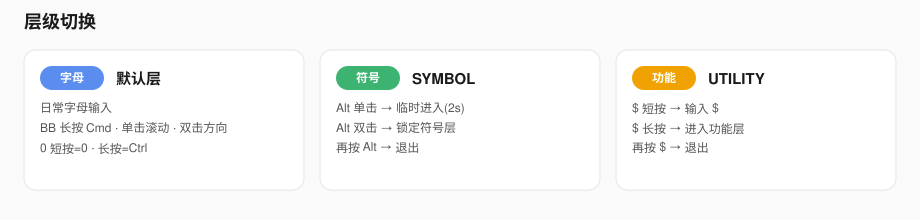
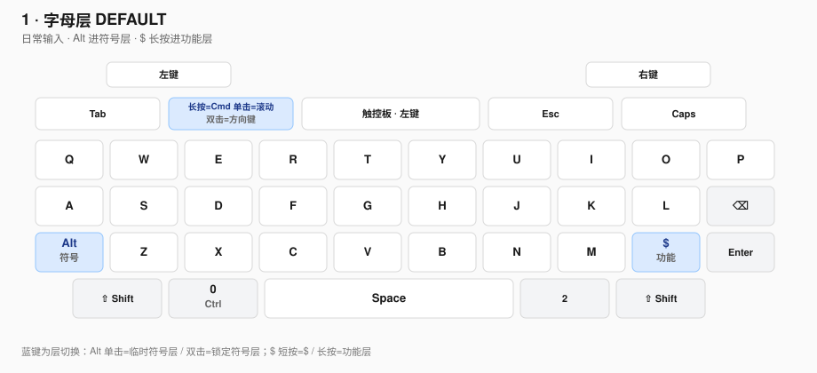
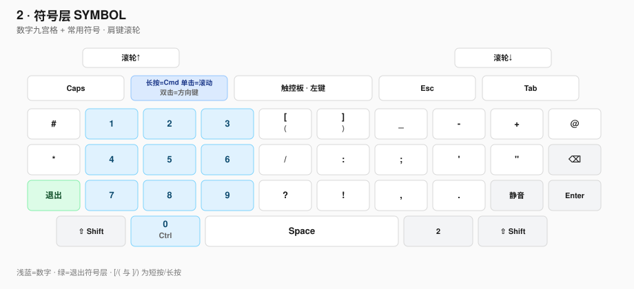
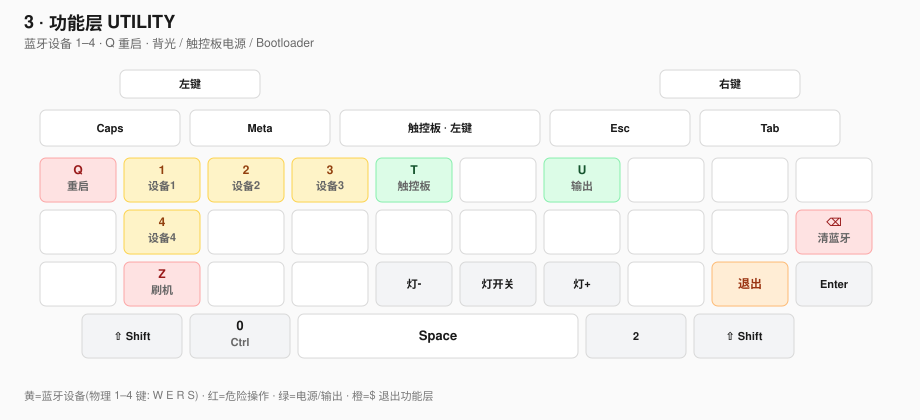

# 黑莓 Q10 蓝牙键盘 · ZMK 配置

仓库：[KyleBing/zmk_config_Q10](https://github.com/KyleBing/zmk_config_Q10)

> 按键与行为参考：  
> [ZMK Key Codes](https://zmk.dev/docs/codes) · [ZMK Behaviors](https://zmk.dev/docs/behaviors)

主要改这些文件：

- [`config/bbq10.keymap`](config/bbq10.keymap) — 按键
- [`config/bbq10.conf`](config/bbq10.conf) — 触控板速度 / 滚动 / 方向键手感
- [`config/west.yml`](config/west.yml) — 固件源（`KyleBing/zmk` · `bbkeyboard_tp-q10-modes`）

---

## 一、共 3 层

| 层 | 作用 |
|----|------|
| 字母层 | 字母、Shift、Ctrl |
| 符号层 | 数字、常用符号、肩键滚轮 |
| 功能层 | 蓝牙设备 1–4、重启、背光、触控板电源、输出切换、刷机 |

### 1. 字母层

| 物理键 | 功能 |
|--------|------|
| 左肩 / 右肩 | 鼠标左键 / 右键 |
| Call | Caps Lock（只切大小写，**不再**控制滚动） |
| **Blackberry** | **单击：滚动 ↔ 鼠标；双击：方向键 ↔ 鼠标** |
| 触控板按下 | 鼠标左键 |
| Back | Esc |
| 挂断 | Tab |
| Alt | 单击临时进符号层；双击锁定符号层 |
| `$` | 短按 `$`；长按进功能层 |
| `0` | 短按 `0`；长按 Ctrl |
| SYM 位置 | `2` |
| 其余 | 印刷字母 |

### 2. 符号层

| 物理键 | 功能 |
|--------|------|
| 左肩 / 右肩 | 滚轮上 / 下 |
| **Blackberry** | 同字母层：单击滚动、双击方向键 |
| Q–P | `#` `1` `2` `3` `(` / `[` `)` / `]` `_` `-` `+` `@` |
| A–⌫ | `*` `4` `5` `6` `/` `:` `;` `'` `"` ⌫ |
| Z–Enter | `7` `8` `9` `?` `!` `,` `.` 静音 Enter |
| Alt | 退出符号层 |
| `$` | 静音 |

`T` / `Y`：短按 `(` `)`，长按 `[` `]`。

### 3. 功能层

| 物理键 | 功能 |
|--------|------|
| **Q** | 键盘重启 (`sys_reset`) |
| **1 / 2 / 3 / 4**（W / E / R / S） | 切换蓝牙设备 1–4 |
| **T** | 触控板电源开关 |
| **U** | USB ↔ 蓝牙输出切换 |
| **⌫** | 清除全部蓝牙配对 |
| **Z** | 进入 Bootloader（刷固件） |
| **V / B / N** | 背光减 / 开关 / 加 |
| **$** | 退出功能层 |
| **Blackberry** | 同字母层：单击滚动、双击方向键 |

---

## 二、层级切换

1. **符号层**
   - `Alt` **单击**：临时进入符号层（约 2 秒内按键后自动退出），上层 4 灯长亮
   - `Alt` **双击**：锁定符号层；再按 `Alt` 退出
2. **功能层**
   - `$` **短按**：输入 `$`
   - `$` **长按**：进入功能层，上层 4 灯 2 闪一顿；再按 `$` 退出

---

## 三、触控板模式（Blackberry 键）

默认是鼠标移动。**不再用 Caps Lock 切换滚动**。

| 操作 | 模式 | 触控板灯（中间） |
|------|------|------------------|
| Caps Lock | 仅大小写 | **长亮**（和原来一样） |
| Blackberry **单击** | 滚动 ↔ 鼠标 | 滚动时 **2 闪一顿**循环 |
| Blackberry **双击** | 方向键 ↔ 鼠标 | 方向键时 **4 闪一顿**循环 |

上层 4 灯（Call / BB / Back / 挂断，共用一路，不能单颗亮）：符号层长亮，功能层 2 闪一顿。

手感在 [`config/bbq10.conf`](config/bbq10.conf) 里调：

- `CONFIG_TRACKPAD_SCROLL_INTERVAL`：滚动位移/格（越大越慢）；松手后惯性减速
- `CONFIG_TRACKPAD_ARROW_THRESHOLD`：累积多少位移发一次方向键（越大越钝）
- `CONFIG_TRACKPAD_ARROW_INTERVAL`：每次方向键后的间隔毫秒（越大连发越慢）

原先 Blackberry 上的 `Win/Cmd` 已让给模式切换。

---

## 四、如何编译与刷入

### 1. Fork / 克隆本仓库

### 2. 编辑 keymap

修改 [`config/bbq10.keymap`](config/bbq10.keymap) 后提交。

### 3. GitHub Actions 出固件

打开仓库 **Actions**，等待构建完成，下载产物 `firmware.zip`，解压得到 `bbq10-zmk.uf2`。

### 4. 刷入

1. USB 连接键盘，进入 Bootloader（功能层按 **Z**，或以说明书为准）
2. 电脑出现名为 `NICENANO` 的磁盘
3. 将 `.uf2` 拖入该磁盘；提示磁盘弹出即完成

macOS 上偶发「磁盘未正确推出」属正常现象。

---

## 五、文档图示

| 文件 | 说明 |
|------|------|
| [`docs/layer-switch.svg`](docs/layer-switch.svg) | 三层切换总览 |
| [`docs/layer-default.svg`](docs/layer-default.svg) | 字母层 |
| [`docs/layer-symbol.svg`](docs/layer-symbol.svg) | 符号层 |
| [`docs/layer-util.svg`](docs/layer-util.svg) | 功能层 |
